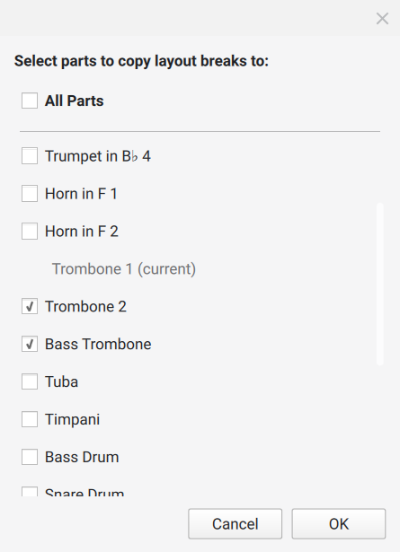

# Apply Layout to Parts

Applies the current score or part system layout to selected parts.

## Usage

While viewing the main score or any part, run Plugins / Apply Layout to Parts.
In the dialog that appears,
select the parts to which you wish to copy the current layout,
and hit OK.
The layout of current score or part layout will be applied to the selected parts.

## Screenshot

## Download

The ZIP file for the current release is available for download in the Releases section of the GitHub repository:

**[** Download **](https://github.com/MarcSabatella/apply-layout-to-parts/releases)**

## Credits

- Created by Marc Sabatella ([Outside Shore Music](https://outsideshore.com)).
- Based on [breaksExporter](https://github.com/ecstrema/breaksExporter), by [Rémi Marche](https://github.com/ecstrema).
- Developed with assistance from Google Gemini.
